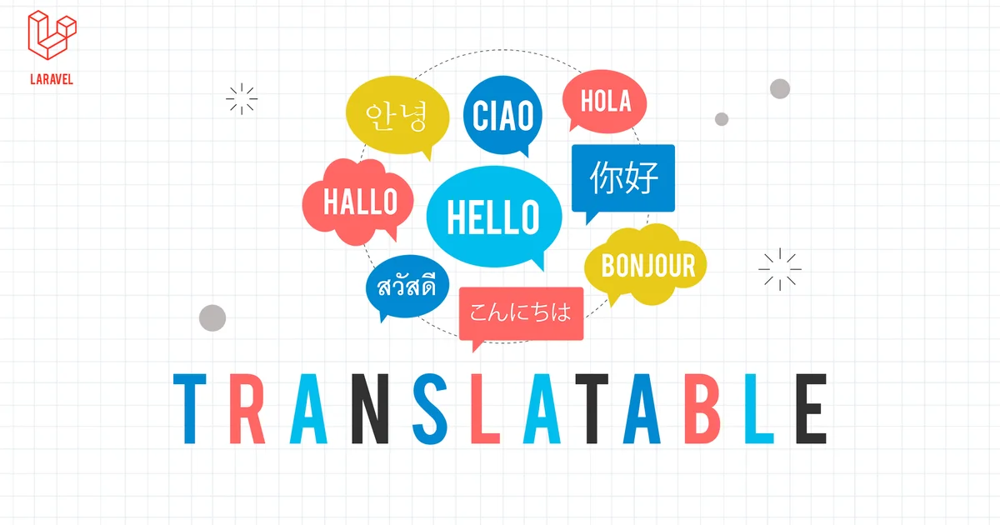

<p align="center"><a href="https://pharaonic.dev/packages/laravel/translatable" target="_blank"></a></p>

<p align="center">
  <a href="https://php.net" target="_blank"></a>
  <a href="https://laravel.com" target="_blank"></a>
  
  
  <br>
  <a href="https://packagist.org/packages/Pharaonic/laravel-translatable" target="_blank"></a>
  <a href="https://packagist.org/packages/pharaonic/laravel-translatable" target="_blank"></a>
  <a href="https://packagist.org/packages/pharaonic/laravel-translatable" target="_blank"></a>
  <a href="https://pharaonic.dev/packages/laravel/translatable#ai-ready" target="_blank"></a>
</p>

<h3 align="center">Translated Eloquent fields in three storage strategies, a translations table, a JSON column per field or a column per locale, behind one API.</h3>
<br>

## Installation

```bash
composer require pharaonic/laravel-translatable
```

The service provider is registered automatically. Publish the configuration when you need to change it:

```bash
php artisan vendor:publish --tag=translatable-config
```

## Usage

```php
use Illuminate\Database\Eloquent\Model;
use Pharaonic\Laravel\Translatable\Contracts\JsonTranslatable;
use Pharaonic\Laravel\Translatable\Translatable;

class Post extends Model implements JsonTranslatable   // or TableTranslatable, ColumnsTranslatable, or none for the default
{
    use Translatable;

    protected $translatables = ['title', 'body'];
}

$post = new Post;
$post->setTranslation('title', 'en', 'Hello')->setTranslation('title', 'ar', 'مرحبا')->save();

$post->title;                          // the current locale, with the fallback locale when missing
$post->getTranslation('title', 'ar');  // exactly what is stored for Arabic, or null
Post::whereTranslation('title', 'Hello', 'en')->get();
```

## Documentation

Full documentation: [Laravel Translatable Documentation](https://pharaonic.dev/packages/laravel/translatable).

## Support & Security

See [SUPPORT.md](SUPPORT.md) and [SECURITY.md](SECURITY.md). Contributions are welcome; see [CONTRIBUTING.md](CONTRIBUTING.md).

## License

MIT. See [LICENSE](LICENSE).
